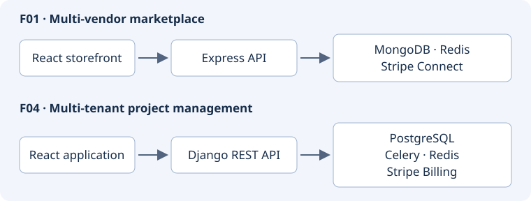

# f1 | Final Project Submission

This repository contains both internship projects, including their application code, tests, and technical documentation.

| Project | Product | Source |
| --- | --- | --- |
| FS-01 | Multi-Vendor E-Commerce Marketplace | [F01](F01/README.md) |
| FS-04 | Multi-Tenant SaaS Project Management Platform | [F04](F04/README.md) |

## FS-01 · Multi-Vendor E-Commerce Marketplace

Shoppers can browse products from multiple vendors and check out through a single storefront. Vendors manage listings and fulfill orders. Administrators oversee marketplace operations.

- **Shopping** — Product catalog, search, cart, coupons, checkout, order tracking, and post-delivery reviews.
- **Vendor operations** — Onboarding, product management, and fulfillment.
- **Payments** — Stripe Connect integration, vendor transfers, and PDF invoices.
- **Implementation** — [React and Vite frontend](F01/front/) and [TypeScript and Express API](F01/back/), backed by MongoDB and Redis.

## FS-04 · Multi-Tenant SaaS Project Management Platform

Teams plan and track work in isolated workspaces. Workspace membership and roles control access to projects and their data.

- **Project planning** — Projects, drag-and-drop boards, configurable workflows, issues, and sprints.
- **Collaboration** — Workspace roles, comments, attachments, and audit events.
- **Operations** — Workspace-level Stripe Billing, notifications, asynchronous reports, and outgoing webhooks.
- **Implementation** — [React and Vite frontend](F04/frontend/) and [Django REST API](F04/backend/), with `django-multitenant`, PostgreSQL, Celery, and Redis.

## Architecture and API documentation



| Project | Architecture and data | API |
| --- | --- | --- |
| FS-01 | [Backend architecture](F01/docs/architecture/backend.md) · [Conceptual data model](F01/docs/conceptual_model.md) | [OpenAPI specification](F01/docs/api/openapi.yaml) |
| FS-04 | [Domain model](F04/docs/domain-api.md) · [Background jobs](F04/docs/architecture/background_jobs.md) · [Billing](F04/docs/architecture/billing.md) | [Workspace-scoped API](F04/docs/domain-api.md) |

## Run locally

Use Docker with the Compose plugin. Run each block from the repository root. Configure local environment files using the examples before starting the services.

### FS-01

```bash
cd F01
cp -n back/.env.example back/.env
docker compose up --build
```

Open [the storefront](http://localhost:5173). The API listens on port 3000. See the [backend setup](F01/back/README.md) for integration configuration and demo data, and the [frontend setup](F01/front/README.md) for Vite and Playwright commands.

### FS-04

```bash
cd F04
cp -n backend/.env.example backend/.env
docker compose up --build frontend backend postgres redis celery-worker celery-beat
```

Open [the project management app](http://localhost:3001). The API listens on port 8000. See the [project documentation](F04/README.md) and [billing setup](F04/docs/architecture/billing.md) for Stripe test-mode configuration.

## Test results

The linked reports describe recorded runs and their scope.

| Project | Recorded result | Evidence |
| --- | --- | --- |
| FS-01 | 17/17 webhook handler tests passed in the run documented in the final report, including duplicate-delivery coverage. | [Final report](F01/FINAL_REPORT.md) · [Test audit](F01/docs/analysis/TEST-AUDIT-REPORT.md) |
| FS-04 | 231/231 Django tests passed on PostgreSQL in the run documented in the delivery checklist. | [Delivery checklist](F04/docs/delivery-checklist.md) |

## Final deliverables

| Deliverable | Evidence or remaining work |
| --- | --- |
| Working demos and screenshots | Add a deployed URL or screen recording for each project and link screenshots of the main flows. |
| Public GitHub repository | Include both project folders, source code, tests, setup instructions, and a clean commit history. Verify public access before submitting the URL. |
| Architecture and API or data documentation | See [Architecture and API documentation](#architecture-and-api-documentation). |
| Test results and relevant measurements | See [Test results](#test-results). Attach relevant performance measurements when available, with the environment and method. |
| Final presentation | Add the slides or recording for the 10-minute presentation. |
| Individual reflections | Add one reflection per intern covering what they owned, what they learned, and what they would do differently. |

### 10-minute presentation outline

| Time | Topic |
| --- | --- |
| 0:00–1:00 | Explain the problems each project addresses and who uses it. |
| 1:00–3:00 | Walk through both architectures, including marketplace payments and workspace isolation. |
| 3:00–7:00 | Demo an FS-01 checkout and an FS-04 issue moving through a board workflow. |
| 7:00–9:00 | Explain implementation challenges and show the test results and available measurements. |
| 9:00–10:00 | Summarize the results and next steps. |

**Submission is one-time.** Verify that the repository is public and that all deliverables open before submitting its URL. Submission locks the deliverables and sends them to the technical evaluation team.
